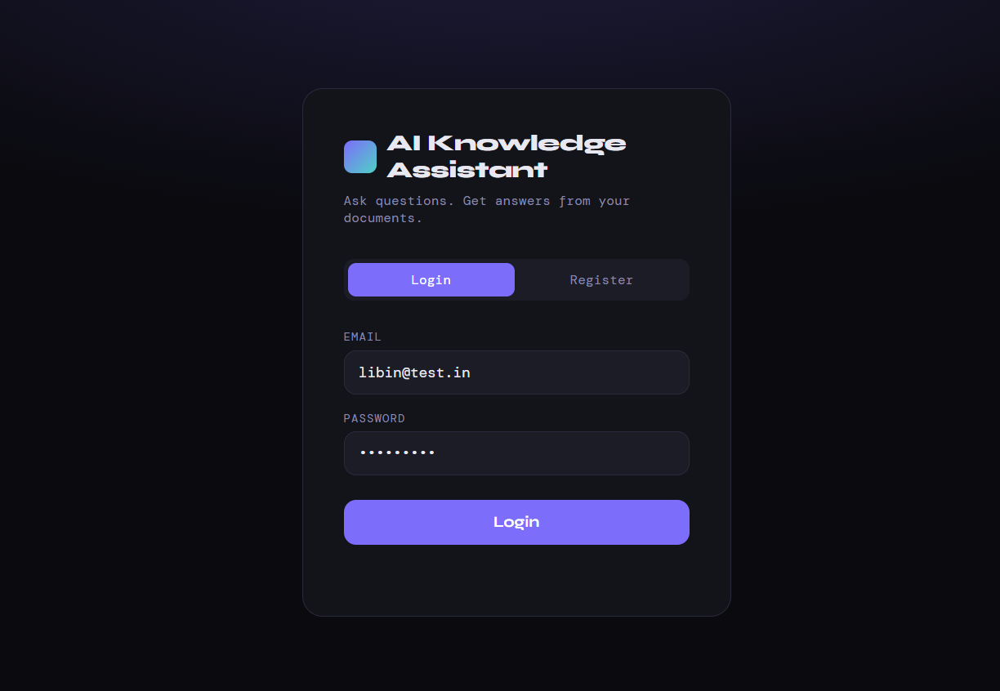
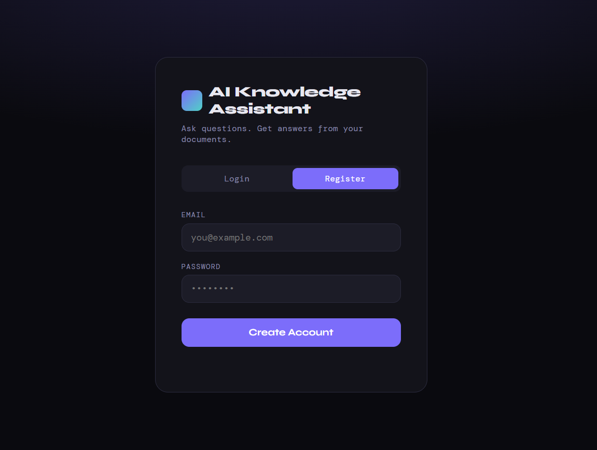
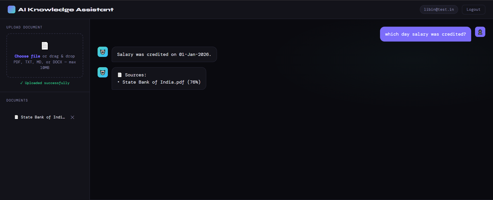
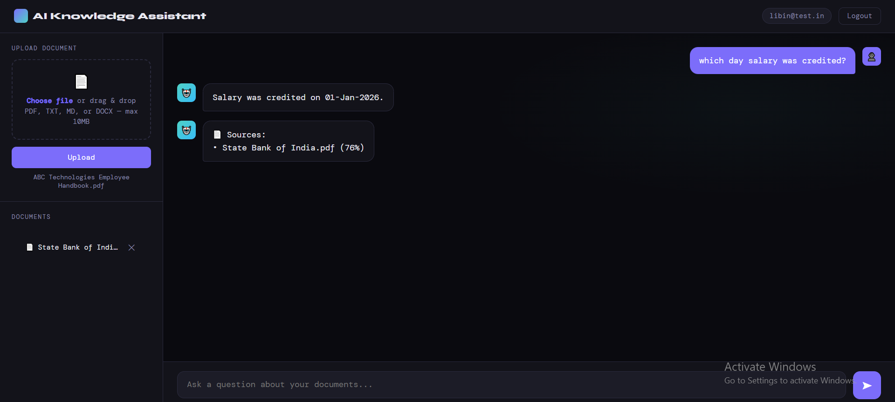
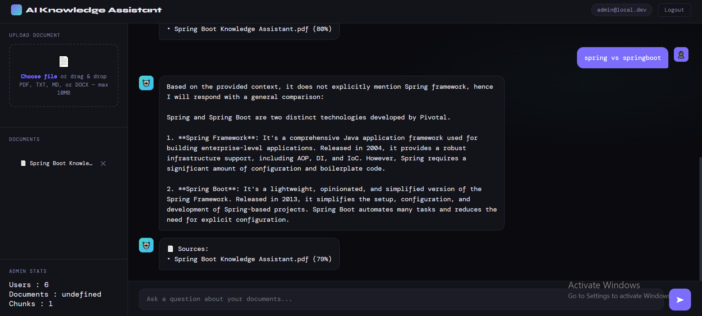

# AI Knowledge Assistant

AI Knowledge Assistant is a Spring Boot application for uploading documents and asking questions against them with a Retrieval-Augmented Generation (RAG) workflow. Documents are parsed, chunked, embedded, stored in PostgreSQL with pgvector, and queried with semantic search before sending context to a Groq-hosted LLM.

## Features

- User registration, login, refresh tokens, logout, and logout from all devices.
- JWT-based stateless authentication with access and refresh token TTLs.
- Role-based authorization for user and admin endpoints.
- Document upload for PDF, TXT, Markdown, and DOCX files.
- Text extraction, chunking, embedding, and storage for uploaded documents.
- Semantic document search using PostgreSQL and pgvector.
- RAG question answering with source references.
- Document listing and deletion.
- Admin statistics for users, documents, and chunks.
- Flyway-managed database migrations.
- Simple static web UI served from Spring Boot.
- Request rate limiting with Bucket4j.

## Tech Stack

| Layer | Technology |
| --- | --- |
| Language | Java 21 |
| Framework | Spring Boot 3.5.10 |
| Build Tool | Maven |
| Web | Spring MVC, static HTML/CSS/JavaScript |
| Security | Spring Security, JJWT |
| Persistence | Spring Data JPA, Hibernate |
| Database | PostgreSQL 16 with pgvector |
| Migrations | Flyway |
| Embeddings | Hugging Face Text Embeddings Inference |
| LLM | Groq OpenAI-compatible API |
| File Parsing | Apache PDFBox, Apache POI |
| Rate Limiting | Bucket4j |
| Deployment | Docker, Docker Compose |

## Architecture Diagram

### High-Level Design

```text
|----------------------|
|      User Browser    |
|----------------------|
           |
           v
|----------------------|
|   Static Web UI      |
|   index.html         |
|----------------------|
           |
           v
|------------------------------------------------------------------|
|                    Spring Boot API :8080                         |
|------------------------------------------------------------------|
| SecurityFilterChain | JwtAuthenticationFilter | RateLimitFilter   |
|---------------------|-------------------------|------------------|
| AuthController      | RagController           | AdminController  |
| /api/auth/**        | /api/rag/**             | /api/admin/**    |
|---------------------|-------------------------|------------------|
           |                    |                     |
           v                    v                     v
|------------------|   |----------------------|   |------------------|
| Auth Services    |   | RAG Services         |   | Admin Service    |
| User/JWT/Refresh |   | Ingest/Query/Search  |   | Stats            |
|------------------|   |----------------------|   |------------------|
           |                    |                     |
           v                    v                     v
|------------------|   |----------------------|   |------------------|
| PostgreSQL       |   | Embedding Server     |   | PostgreSQL       |
| Users/Roles      |   | BAAI/bge-small       |   | Counts/Stats     |
| Tokens/Audit     |   | POST /embed          |   |                  |
|------------------|   |----------------------|   |------------------|
                                |
                                v
                     |----------------------|
                     | PostgreSQL + pgvector|
                     | documents/chunks     |
                     | vector(384) search   |
                     |----------------------|
                                |
                                v
                     |----------------------|
                     | Groq API             |
                     | LLM answer generation|
                     |----------------------|
```

### Low-Level RAG Flow

```text
|----------------|
| User uploads   |
| PDF/TXT/MD/DOCX|
|----------------|
        |
        v
|-------------------------|
| POST /api/rag/ingest    |
| Multipart file + JWT    |
|-------------------------|
        |
        v
|-------------------------|
| FileParser              |
| Extracts plain text     |
|-------------------------|
        |
        v
|-------------------------|
| DocumentService         |
| Creates document record |
| Splits text into chunks |
|-------------------------|
        |
        v
|-------------------------|
| EmbeddingClient         |
| Calls /embed service    |
|-------------------------|
        |
        v
|-------------------------|
| PostgreSQL + pgvector   |
| Stores chunk embeddings |
|-------------------------|

|----------------|
| User asks      |
| a question     |
|----------------|
        |
        v
|-------------------------|
| POST /api/rag/query     |
| question + JWT          |
|-------------------------|
        |
        v
|-------------------------|
| RagQueryService         |
| Embeds the question     |
|-------------------------|
        |
        v
|-------------------------|
| SimilaritySearchService |
| Finds top chunks        |
|-------------------------|
        |
        v
|-------------------------|
| GroqClient              |
| Sends context + question|
|-------------------------|
        |
        v
|-------------------------|
| QueryResponse           |
| Answer + source chunks  |
|-------------------------|
```

### Authentication Flow

```text
|----------------------|
| Login/Register UI    |
|----------------------|
           |
           v
|----------------------|
| AuthController       |
| /api/auth/**         |
|----------------------|
           |
           v
|----------------------|
| AuthenticationService|
| Validates password   |
| Loads roles          |
|----------------------|
           |
           v
|----------------------|
| JwtService           |
| Access token         |
| Refresh token        |
|----------------------|
           |
           v
|----------------------|
| RefreshTokenService  |
| Stores refresh JTI   |
| Supports revocation  |
|----------------------|
           |
           v
|----------------------|
| PostgreSQL           |
| users/roles/tokens   |
|----------------------|
```

## Running Locally

### Prerequisites

- Java 21
- Docker and Docker Compose
- Groq API key

### Environment Variables

Create a local `.env` file or export these values in your shell:

```env
DB_USERNAME=postgres
DB_PASSWORD=changeme
JWT_SECRET=replace-with-a-long-base64-or-strong-secret
GROQ_API_KEY=replace-with-your-groq-api-key
GROQ_BASE_URL=https://api.groq.com/openai/v1
GROQ_MODEL=llama-3.1-8b-instant
EMBEDDING_SERVER_URL=http://localhost:8081/embed
```

### Start Dependencies

Start PostgreSQL with pgvector and the embedding server:

```bash
docker compose up -d db embedder
```

The database is exposed on port `5433` and the embedding service is exposed on port `8081`.

### Run the Application

On Windows:

```bash
mvnw.cmd spring-boot:run
```

On macOS/Linux:

```bash
./mvnw spring-boot:run
```

The app will be available at:

```text
http://localhost:8080
```

Flyway runs automatically at startup and applies the migrations in `src/main/resources/db/migration`.

### Useful API Endpoints

| Method | Endpoint | Description |
| --- | --- | --- |
| `POST` | `/api/auth/register` | Register a user |
| `POST` | `/api/auth/login` | Login and receive access/refresh tokens |
| `POST` | `/api/auth/refresh` | Refresh JWT tokens |
| `POST` | `/api/auth/logout` | Revoke a refresh token |
| `POST` | `/api/auth/logout-all` | Revoke all user sessions |
| `POST` | `/api/rag/ingest` | Upload and ingest a document |
| `POST` | `/api/rag/query?question=...` | Ask a question against uploaded documents |
| `GET` | `/api/rag/documents` | List documents |
| `DELETE` | `/api/rag/documents/{id}` | Delete a document |
| `GET` | `/api/admin/stats` | Admin-only application stats |

## Deployment

### Build the JAR

```bash
mvnw.cmd clean package
```

On macOS/Linux:

```bash
./mvnw clean package
```

### Run with Docker Compose

Set production environment variables first:

```env
DB_USERNAME=postgres
DB_PASSWORD=changeme
JWT_SECRET=replace-with-a-production-secret
GROQ_API_KEY=replace-with-your-groq-api-key
```

Then build and start the services:

```bash
docker compose up --build
```

Production containers include:

- `app`: Spring Boot application on port `8080`
- `db`: PostgreSQL with pgvector
- `embedder`: Hugging Face embedding server

Before deploying, verify the Docker configuration values match your environment, especially database names, image names, and JVM options.

## Screenshots

### Login



### Register



### Document Chat



### Document Upload



### Admin Stats



### Known Limitations

- Retrieval quality depends on embedding similarity thresholds.
- LLM responses may occasionally use general knowledge when document context is insufficient.
- Current implementation prioritizes simplicity over advanced reranking techniques.


Refer SYSTEM DESIGN.md and  ARCHITECTURE.md for more detailed information